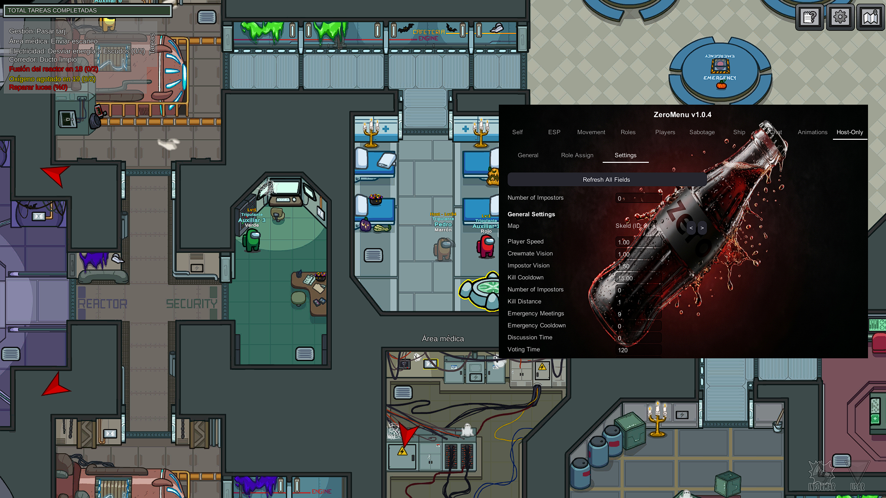

# ZeroMenu 🚀
> **The Tuff, Best, And All Tuff Menu**

  
  
  
  

**ZeroMenu** Mod For Among Us!

---

## 📖 About: About Tab
Displays the basic information about the menu, including the current version and credits to the developers.

## 📖 About: Self Tab
Focuses on personal player modifications for the local player.
*   **Immortality**: Uses the ventilation system bypass to prevent you from being killed.
*   **Phantom**: A custom invisibility cheat that visually reduces your alpha and teleports you off-map.
*   **Actions**: Call Meeting, Complete All Tasks.
*   **Avatar Controls**: Snipe Color, Target Color ID, and a Restore Avatar button.
*   **Freeplay Stats**: Toggle to update your stats even while in Freeplay mode.

## 📖 About: ESP Tab
Provides visual enhancements and information normally hidden from the player.
*   **Visuals**: See Roles (in nametags), See Player Info, See Ghosts, No Shadows, Reveal Votes.
*   **Tracers**: Draws lines from your character to Crewmates, Impostors, Ghosts, and Dead Bodies (with color-based options).
*   **Camera**: Zoom Out using the mouse wheel, and Freecam to detach the camera from your player.

## 📖 About: Movement Tab
Dedicated to player mobility and map navigation.
*   **Noclip**: Disables your Collider2D to walk through walls.
*   **Invert Controls**: Reverses your movement direction.
*   **Speed Modifier**: A slider that multiplies your `TrueSpeed` up to 5x.
*   **Teleport**: Teleport to Cursor (Right-Click) and a list of predefined map locations.

## 📖 About: Roles Tab
Allows you to manipulate your current role or force specific actions.
*   **Impostor**: Kill Anyone, Kill Reach, Kill While Vanished, Kill Other Impostors.
*   **Shapeshifter**: Endless Shapeshift Duration, No Shapeshift Animation.
*   **Engineer**: Endless Vent Time, No Vent Cooldown.
*   **Scientist**: Endless Battery, No Vitals Cooldown.
*   **Tracker**: Endless Tracking, No Tracking Delay.
*   **Phantom**: No Vanish Cooldown, Endless Vanish Duration.
*   **Judge**: Instant Overrule Unlock, Infinite Gavels.
*   **Influencer**: No Refresh Cooldown.

## 📖 About: Players Tab
Manage other players in the lobby or during the game.
*   **General**: Teleport, Murder, Telemurder, Shapeshift Into, Protect, Copy Avatar, Report Body.
*   **Vents**: Teleport to specific vents.
*   **Player Actions**: Follow Player, Pet Player, Jail Player, Whisper, Spectate, Immortal.
*   **Host-Only Actions**: Revive, Force Meeting As, Force All Votes To, Eject, Ban Exploit, Frame Shapeshift, Flood Tasks, Clear Tasks.
*   **Exploits**: Send Fake Lights, Fake Oxygen, Fake Reactor, Door Hallucination.
*   **Manage**: Kick, Votekick.

## 📖 About: Sabotage Tab
Trigger map sabotages regardless of your role.
*   **Sabotages**: Reactor, Oxygen, Lights, Comms, Mushroom Mixup (Fungle).
*   **Doors**: Close or Open specific doors.
*   **Bulk Actions**: Sabotage All, Fix All, Lock All, Unlock All.

## 📖 About: Ship Tab
Manipulate the ship's mechanics and game flow.
*   Unfixable Lights.
*   Call Meeting and Close Meeting.
*   Auto-Report Dead Bodies.
*   Unlock Vents, Kick All From Vents, Walk in Vents.
*   Trigger Spores (Fungle).

## 📖 About: Chat Tab
Modifies the game's chat system.
*   Enable Chat anytime (even in the lobby).
*   Unlock Clipboard (Copy/Paste/Cut).
*   Bypass URL Block (Replaces dots with commas so it sends).
*   Allow Longer Messages.
*   Dark Mode.
*   Custom Chat Color (Color as Player or HTML Color).

## 📖 About: Host-Only Tab
Cheats that only work if you are the lobby host.
*   **General**: Kill Anyone, Kill Ghosts, No Kill Cooldown, No Task Mode, No Settings Limit, Ban Players Mid-Game.
*   **Protections**: God Mode, God Mode Everyone, Auto Angel, Protect Everyone.
*   **Murder**: Kill All Crewmates, Kill All Impostors, Kill Everyone.
*   **Game State**: Force Start Game, Modify Start Countdown, Disable Meetings, Disable Sabotages, Disable Close Doors, Disable Cameras, Disable Game End, Disable Vent Clean, Disable All Votekicks.
*   **Meetings**: Skip Meeting, Vote Immune, Judge Immune.
*   **Players**: Spam Report Bodies, Block Low Levels.
*   **End Game**: Crewmate Win, Impostor Win, Imp Disconnect, Kick All.
*   **Shapeshift Controls**: Shapeshift Everyone Into Me/Random, Revert All.
*   **Role Manager**: Pre-Game Role Forcing.
*   **Map Spawner**: Spawn/Despawn Lobby or Map.
*   **Disco Party**: Change everyone's color rapidly.
*   **Sub-Tabs**: General, Role Assign, Settings.

## 📖 About: Passive Tab
Quality of life features that run in the background.
*   **Free Cosmetics**: Unlocks all hats, visors, and skins.
*   **Avoid Penalties**: Removes disconnect penalties.
*   **Unlock Features**: Freechat, Friend list, Custom name, Online gameplay.
*   **Spoof April Fools**: Changes the server date to April 1st.
*   **Privacy**: Hide Device ID, Copy Lobby Code on Disconnect.

## 📖 About: Troll Tab
Functions to mess with other players.
*   **Automatically Report Bodies**: Instantly reports any body killed.
*   **Queue Lobby Crash**: Crashes the lobby when the game starts.
*   **Disable Vents**: Kicks anyone who tries to enter a vent.
*   **Block Sabotages**: Prevents any sabotage from being triggered.
*   **Door Troller**: Automatically opens and closes all doors at a set interval.
*   **Auto Expose Impostors**: Teleports crewmates to vents when an impostor kills/shapeshifts (Murder, Shapeshift, Phantom).
*   **Vent Teleport**: Teleports everyone to a specific vent or a random vent.
*   **Actions**: Disconnect All (non-host), Trigger All Spores, Copy Random Player, Disable Killing, Deplete HnS Timer.

## 📖 About: Tuff Tab
Miscellaneous tools.
*   **Votekick Everyone**: Votekicks all players.
*   **Votekick Only Host**: Votekicks only the host.
*   **Always Red**: Forces your color to Red.
*   **Rejoin Last Game**: Rejoins the last lobby.
*   **Set Ping**: Sends a ping to the server.
*   **Disconnect All Players**: Disconnects all other players.

## 📖 About: Spoof Tab
Identity masking for privacy.
*   **Player Level**: Spoof Level (Mask your real level).
*   **Platform**: Spoof Platform (Make others think you are on Steam, Epic, etc.).
*   **Version**: Spoof Version (Fake an older version of the game).
*   **Privacy & Account**: Spoof Guest Account, Spoof Friend Code, Hide Device ID, Spoof April Fools Date.
*   **Discord Activity**: Custom rich presence for Discord.

## 📖 About: Protections Tab
Protections against other cheaters and exploits.
*   **Network**: Force DTLS, Block Server Teleports.
*   **RPC Checks**: Hardened Read Packed UInt, Block Invalid Ladder Overload, Block Large Game Messages, Block Invalid Game Data Messages, Block Unauthorized System Updates, Protect Against Non-Host Kick Exploit.
*   **Exploits**: Block Zipline Force, Block Vent TP Force, Prevent Votekicks, Protect Against VotingComplete Overloads, Bypass Ratelimit for Shapeshift RPC.
*   **Anti-Crash**: Protect against report-body crash exploit.
*   **Anti-Exploits**: Full system that analyzes Hazel packets and RPCs for malicious patterns.
*   **Show Protections**: Keeps the protection animation visible.

## 📖 About: Anticheat Tab
Bypasses for Innersloth's internal anticheat.
*   Enable/Disable Anticheat.
*   Flag Spoofed Platform Data.
*   Configure which RPCs should be checked.
*   Configure punishment: None, Kick, Error Kick, Ban.
*   Send notification and/or discard RPC.

## 📖 About: Config Tab
Menu configuration settings.
*   **General**: Log chat to console, Clear Notifications, Menu Keybind, Menu Color.
*   **Config Management**: Save/Load Config, Save/Load Profile, Open Config File.
*   **Spoofing**: Enable Version Spoofing, Spoofed Version selection, Modded Protocol, Spoofed Platform, Spoof Level, Hide Device ID.

---

# ⚠️ Disclaimer

This mod is not affiliated with Among Us or Innersloth LLC, and the content contained therein is not endorsed or otherwise sponsored by Innersloth LLC. Portions of the materials contained herein are property of Innersloth LLC. © Innersloth LLC.

This mod is not intended to be used in any manner that interferes with Innersloth's services, Innersloth's operation of Among Us, the integrity or availability of the game, or the normal gameplay experience of other players. The creator does not endorse, encourage, or condone using this mod to disrupt games, negatively affect other users, bypass rules or protections, or gain an unfair advantage in any setting where such use is prohibited. Any misuse is solely the responsibility of the user.

Usage of this mod can violate the terms of service of Among Us, which may lead to punitive action including temporary or permanent bans from the game. The creator is not responsible for any consequences you may face due to usage. Use at your own risk.
